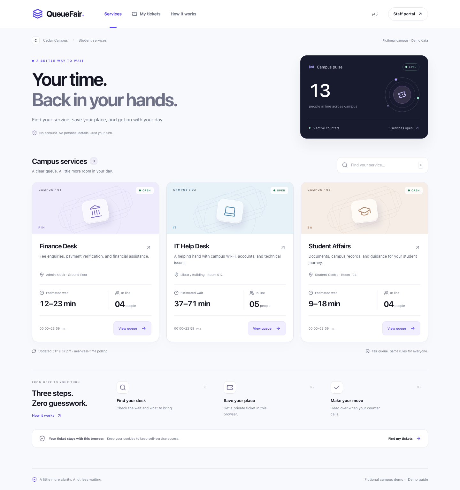

# QueueFair

**Your turn, without the uncertainty.**

An open-source campus queue application for fictional **Cedar Campus**. Students get a private browser-owned ticket and an explainable waiting range; staff operate assigned counters through audited server transitions. Public displays expose tokens, never visit notes or ownership secrets. No affiliation with a real institution is implied.



## Run locally

Prerequisites: Node **24 LTS** (22.12+ or the tested Node 26.12 also work), pnpm 11.25, PostgreSQL 16. Docker Compose is the easiest database option. No paid services or cloud accounts.

```sh
corepack enable
corepack prepare pnpm@11.25.0 --activate
pnpm install --frozen-lockfile
pnpm demo:env  # creates .env with fresh random secrets; refuses to overwrite
```

Alternatively copy `.env.example` manually. If doing so, replace the database password in **both** `POSTGRES_PASSWORD` and the URL (URL-encode special characters). Generate separate random values with `openssl rand -hex 24` for `SESSION_SECRET`, `DEMO_STAFF_PASSWORD`, and `DEMO_ADMIN_PASSWORD`. Passwords need at least 12 characters. Keep actual credentials in ignored environment files. `SESSION_SECRET` needs at least 32 characters.

```sh
docker compose up -d --wait
pnpm db:generate
pnpm db:migrate
pnpm db:seed
pnpm dev
```

Open **http://127.0.0.1:3000**. Use exactly the origin in `APP_ORIGIN`; cookie-authenticated mutations reject other origins. Seed runs only against an empty database with `DEMO_MODE=true`. Startup never resets or seeds the database.

Docker unavailable? Supply your own PostgreSQL 16 instance and set `DATABASE_URL`. Create an empty `queuefair_demo` database owned by your configured user. This app does not fall back to SQLite or browser storage. For an isolated Homebrew instance:

```sh
initdb -D /tmp/queuefair-postgres -A scram-sha-256 -U queuefair -W
pg_ctl -D /tmp/queuefair-postgres -l /tmp/queuefair-postgres.log -o '-p 55432 -h 127.0.0.1' start
createdb -h 127.0.0.1 -p 55432 -U queuefair queuefair_demo
```

Set the URL port to `55432` and use the password supplied to `initdb`. The current development session uses an isolated local instance on port 55432; Docker was not installed in the implementation environment.

## Deploy to Vercel

Follow the [Vercel setup guide](docs/VERCEL.md) for hosted PostgreSQL, environment variables, migrations and seeding. Use `pnpm build`: it generates the Prisma client before compiling Next.js, including on cached builds. Your local database URL cannot be used from Vercel.

## Demo accounts and routes

| Purpose                  | Route / account                                             |
| ------------------------ | ----------------------------------------------------------- |
| Student services         | `/`, `/services/finance-desk`                               |
| Private ticket / history | `/tickets/[publicId]`, `/my-tickets`                        |
| Student instructions     | `/how-it-works`                                             |
| Staff                    | `/login` → `/staff`, `/staff/counters/[counterId]`          |
| Staff email              | `staff@queuefair.demo`, password from `DEMO_STAFF_PASSWORD` |
| Administrator            | `/admin`, `/admin/services`, `/admin/analytics`             |
| Admin email              | `admin@queuefair.demo`, password from `DEMO_ADMIN_PASSWORD` |
| Public display           | `/display/finance-desk`                                     |
| Walkthrough              | `/demo`, [demo guide](docs/DEMO.md)                         |

Use separate browser profiles/incognito windows for student and staff in a demo. The seed includes Student Affairs (two counters, six-minute baseline), Finance Desk (two counters, eight-minute baseline), and IT Help Desk (one counter, ten-minute baseline), with synthetic completed history, waiting, called, serving and eligible missed states. Seeded owners are synthetic and inaccessible to viewers; demonstrate self-service missed/rejoin with a ticket created in your browser. Defaults use 24-hour demo hours except the final minute and a clearly labeled 10-second grace. Configure realistic hours and 120-second grace for normal use.

## Scripts

| Script                              | Purpose                                         |
| ----------------------------------- | ----------------------------------------------- |
| `pnpm dev`                          | Development server, localhost:3000              |
| `pnpm build` / `pnpm start`         | Production build / server                       |
| `pnpm lint` / `pnpm typecheck`      | ESLint / strict TypeScript                      |
| `pnpm format:check` / `pnpm format` | Prettier check / format                         |
| `pnpm test`                         | Pure deterministic domain tests                 |
| `pnpm test:integration`             | Guarded PostgreSQL/concurrency tests            |
| `pnpm test:e2e`                     | Playwright on port 3100 and a separate database |
| `pnpm demo:env`                     | Generate a new ignored .env with fresh secrets  |
| `pnpm db:generate`                  | Generate Prisma 7 client                        |
| `pnpm db:migrate`                   | Deploy committed migrations                     |
| `pnpm db:migrate:test`              | Migrate the test database                       |
| `pnpm db:seed`                      | Seed an empty demo database                     |
| `pnpm db:rollover`                  | Explicit idempotent old-day expiration          |
| `pnpm demo:reset --confirm`         | Destructive demo-only reseed                    |

Reset refuses production, requires `DEMO_MODE=true`, `--confirm`, and a database name ending `_demo`. No browser reset endpoint is provided, even if `ENABLE_DEMO_RESET` is set. Schedule `db:rollover` daily in the campus timezone if operating continuously. Queue mutations also run rollover inside their transaction. GET requests never change queue state.

## Tests

Create **a separate database**, such as `queuefair_test`, with the same owner. Copy `.env` to `.env.test`, set both `DATABASE_URL` and `TEST_DATABASE_URL` to that test database URL, and set `APP_ORIGIN=http://127.0.0.1:3100`. Keep demo passwords populated. Tests refuse destructive cleanup unless the URL values match and the database name ends in `_test`. Never point this file at development or production data.

```sh
createdb -h 127.0.0.1 -U queuefair queuefair_test  # adjust port / user
pnpm db:migrate:test
pnpm exec playwright install chromium
pnpm test
pnpm test:integration
pnpm test:e2e
pnpm lint
pnpm typecheck
pnpm build
```

Integration and browser tests truncate only the guarded test database. Run those two suites sequentially; they share test fixtures. [Verification record](docs/VERIFICATION.md) records actual outcomes, not assumed results.

## Engineering and limitations

Next.js App Router, React, strict TypeScript, Tailwind, Lucide, PostgreSQL, Prisma 7 with the `pg` adapter, Zod, TanStack Query polling, Argon2id, Vitest, and Playwright. Custom accessible controls are used; React Hook Form, shadcn, and chart libraries are omitted where native controls and aggregate cards suffice.

- Transactional FIFO with a service-level row lock, unique per-day sequences, and a partial unique active-counter index. One rejoin moves to the tail and retains the printed token. No manual priority or reordering.
- **Near-real-time polling**, approximately 2 seconds for staff, 3 for ticket/display, and 15 for directory. Hidden-tab polling pauses; focus and reconnect refetch. Failed refreshes retain and label stale data. This is **not an offline ticketing system**.
- A heuristic range uses up to 30 recent valid service durations (30 seconds–2 hours); fewer than five uses the configured baseline. It accounts for active work and parallel counters. It is not an accuracy claim or calibrated confidence interval.
- HttpOnly random capability cookies protect student data; random hashed database sessions protect staff. Clearing cookies may lose self-service access and bypass per-browser limits. There is no strong identity verification.
- The local prototype uses persistent per-account and global login limits, rather than trusting spoofable proxy headers. Configure a trusted network identity and operational limits before broader deployment. No password reset, user provisioning UI, external notifications, or recovery override exists.
- English is complete. Urdu covers core student/display labels with RTL; some explanatory text and staff/admin screens remain English. No browser push, CSV export, or recorded fallback video.
- PostgreSQL is the only supported store. No Redis, AI, payments, SMS, or cloud services. Production requires HTTPS for secure cookies, a configured canonical origin, and a persistent PostgreSQL server.
- No Kiro usage has been recorded. No contributors or measured real-world impact have been fabricated.

See [architecture](docs/ARCHITECTURE.md), [API](docs/API.md), [decisions and dependency references](docs/DECISIONS.md), [contribution guide](CONTRIBUTING.md), and [security policy](SECURITY.md).

## License

[MIT](LICENSE), copyright AlleyNawaz (from local Git metadata).
