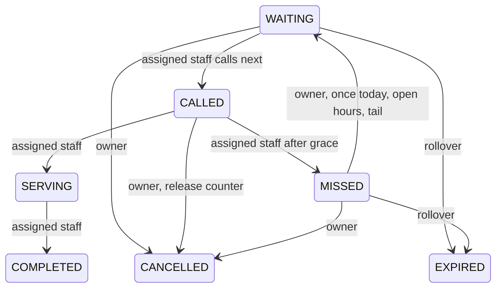

# Architecture

One deployable Next.js application, Node route handlers, PostgreSQL 16, Prisma 7 with `@prisma/adapter-pg`. React server components render route shells and protect staff/admin page entry; interactive views use TanStack Query. Authorization is repeated on every privileged API request. `src/server/queue.ts` owns transitions; route handlers validate Zod inputs and create safe error envelopes.

## Model

User → hashed AuthSessions and StaffAssignments → Service / optional Counter. AnonymousSession → Tickets → TicketEvents. Service → ServiceDay → Tickets. ServiceDay snapshots the prefix on creation so future prefix changes cannot rewrite the current day. Token sequence and queue sequence are independent integers. ActiveParticipation has a unique `(anonymousSessionId, serviceDayId)` and unique ticket ID. IdempotencyRecord stores actor/operation/key, digest, result, and expiry. RateLimitBucket stores keyed HMAC identities and fixed windows. Counter and service changes write ServiceEvents.

Timestamps are UTC (`DateTime`); server policy derives service-local dates with date-fns-tz / Asia/Karachi. Timezone editing is intentionally omitted. Hours are a validated day list and same-day open/close pair; overnight windows are not supported. Seed uses all seven days 00:00–23:59 for demo convenience.

## Transitions

Terminal tickets cannot transition. Grace is checked against the server clock, inclusive at the configured boundary. The browser never marks missed automatically. A first missed ticket retains participation; a second missed ticket releases it and cannot rejoin. Staff can finish existing called/serving work after closing. Going offline requires no active work. Pauses preserve order and allow existing work to finish.

## Transactions and concurrency

Every queue write takes `SELECT id FROM "Service" WHERE id = $id FOR UPDATE` first, then reads its day, counter and ticket state and writes all changes/events in one transaction. This coarser service lock serializes all days of a service, including old-day resolution and rollover. It is adequate for campus demo throughput, avoids separate counter/ticket lock-order deadlocks, and is shared by administrative service changes. No in-process mutex or network call is used. There are at most three attempts for recognized transaction/deadlock failures. Transactions have bounded wait and execution times.

PostgreSQL constraints provide defense in depth: unique service/day, token/day and queue-order/day; active participation uniqueness; a partial unique index on `Ticket.assignedCounterId WHERE status IN ('CALLED','SERVING')`; status, role, state, assignment, sequence, rejoin and settings checks. Prisma cannot express all partial indexes/checks, so the initial SQL migration explicitly creates them. Retain them in future migrations.

Cancellation disconnects a called ticket atomically. Rejoin allocates a fresh queue sequence while keeping token and joinedAt. Call-next selects the earliest current-day WAITING row while locked and refuses any counter with CALLED/SERVING work, including yesterday’s unresolved work. Completion and participation release commit with the audit event. A thrown exception rolls all changes back.

Join, rejoin, call-next and completion require a persisted idempotency key scoped to actor and operation. A replay returns the original result; a changed payload returns 409. State invariants also guard requests with different keys. The browser establishes its capability through an Origin-protected POST before joining; Web Locks serialize this first issuance across tabs when supported. Direct joining without an established owner is rejected.

Rollover is an explicit CLI operation and also runs within queue mutation transactions. It expires only old WAITING/MISSED tickets, releases their participation, preserves all history, and leaves CALLED/SERVING work for authorized staff. GET never expires data. Schedule the CLI daily for continuous operation; until run, an old private ticket may retain its old status, with its local date shown.

## Estimate

Read the latest completed durations, keep only 30 seconds–7200 seconds, then take at most 30 valid samples. At least five valid samples: arithmetic mean; otherwise configured baseline. Raw history is unchanged.

For each ACTIVE counter: idle availability 0; SERVING availability `max(0, average - elapsed)`; CALLED availability `max(0, grace - elapsedCall) + average`. Simulate FIFO tickets, choosing the earliest available counter for each and advancing that counter by average. The target simulated start is its estimate. Display floor(0.75 × seconds / 60) to ceil(1.4 × seconds / 60), minimum one-to-two minute range; below one minute say “You may be called next.” This range is heuristic, never a calibrated confidence interval. Paused/closed/out-of-hours service or zero active counters gives an explained unavailable state.

Waiting time per attempt is captured as `waitSeconds` and attempt number on CALLED events before rejoin resets calledAt and queueEnteredAt. Analytics count event timestamps for missed/rejoin and completion timestamps for completed visits; service duration is completedAt minus serviceStartedAt. Date range is bounded to 93 days and end-exclusive. Demo sample counts and provenance are visible.

## Privacy and updates

Public state explicitly constructs counter token/status, next five tokens, counts and service configuration. It never spreads a ticket database object into a public response. Private reads filter by both public ID and capability owner. Staff overview omits visit notes and reasons. Authentication sessions and capabilities store SHA-256 hashes of 256-bit random secrets. Passwords use Argon2id.

All queue API responses use `Cache-Control: no-store`, with a force-dynamic Node handler and no state-changing GETs. Polling pauses in hidden tabs, refetches on focus/reconnect, backs off retries, retains last fetched data and shows stale errors. The database remains the source of truth. No optimistic queue transitions, WebSockets, Redis, external messaging, or offline issuance.
